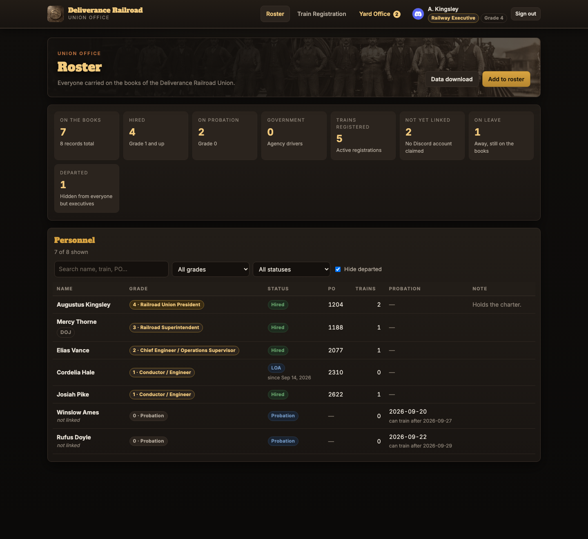
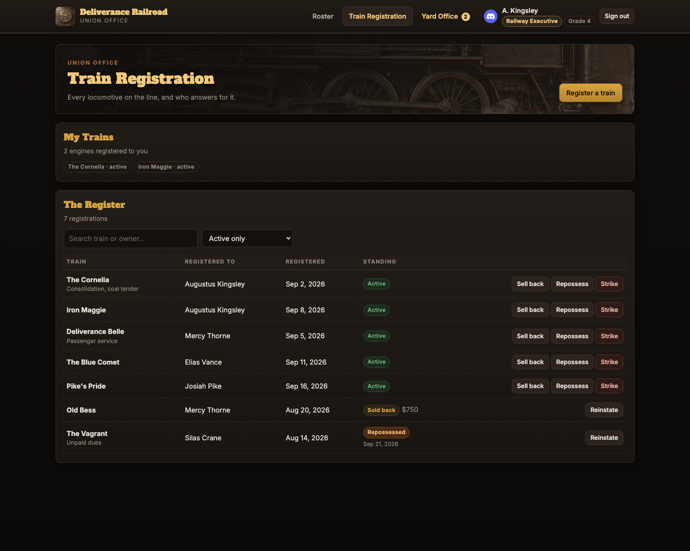
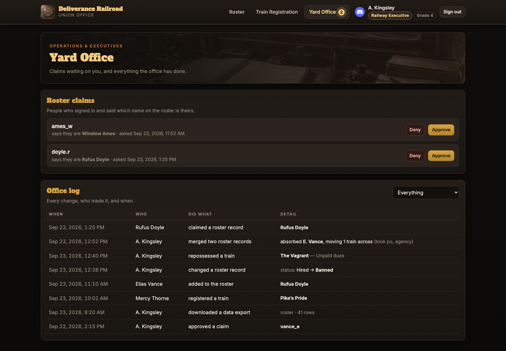
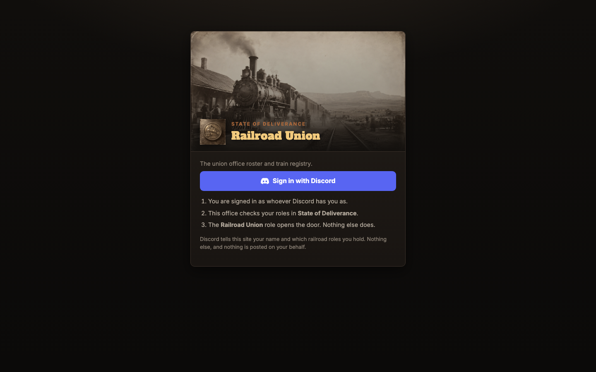
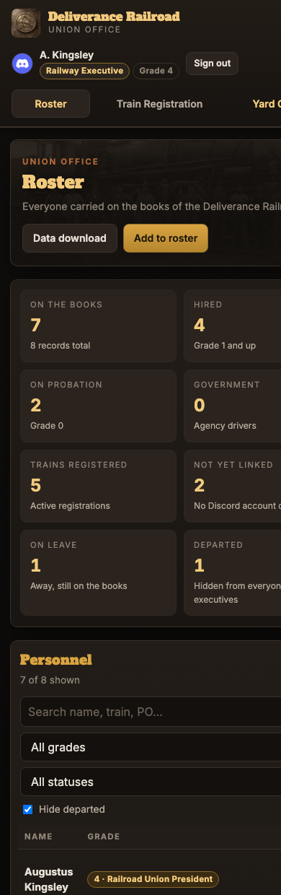
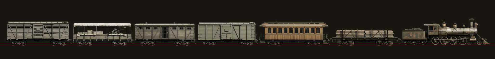

<h1 align="center">Deliverance Railroad Union</h1>

<p align="center">
  A roster and train register for the Railroad Union on the<br>
  <b>State of Deliverance</b> RedM server — 1899 railroad-office styling,<br>
  Discord sign-in, and <b>no bot in anybody's server</b>.
</p>

<p align="center">
  
  
  
  
  
</p>

<p align="center"></p>

---

## What this is

The Railroad Union needed somewhere to keep its books: who is on the roster, what
rank they hold, and which engines are registered to whom. This is that — a small
private site for union members, styled like an 1899 railroad office.

It is **not** connected to the RedM server and does not touch game data.

## The interesting part: there is no bot

Most Discord-gated sites need a bot sitting in your server to read people's roles.
This one does not, and that was the whole design constraint — the union does not
own the State of Deliverance Discord and could not add a bot to it.

Instead it uses plain OAuth2 with two scopes:

| Scope | What it gets |
| --- | --- |
| `identify` | who you are — id, username, avatar |
| `guilds.members.read` | your membership in **one** named guild |

`guilds.members.read` reads roles from the **user's own side** of the connection,
with the user's own consent, so no bot and no server permissions are required.
The lookup is pinned to a single configured guild id, so the app cannot see any
other server you are in.

The access token is used for exactly two reads at sign-in and is **never stored**.
What lands in the session is only: your Discord id, username, display name, avatar
hash, which of three roles you hold, and a timestamp.

All of that is in [`site/api/oauth.php`](site/api/oauth.php) — about 200 lines, and
the best place to start reading.

## Permissions

Discord decides **what you may do**. The roster decides **what rank you are**.

| Discord role | Can |
| --- | --- |
| **Railroad Union** | the door — without it you are refused entry |
| **Railway Operations** | hire onto the roster, edit records, promote up to grade 2, read the office note, and work the Yard Office |
| **Railway Executives** | everything above, plus delete, merge, reassign, the `office` field, and any rank of 3+ |

A roster grade of 3 without the Railway Executives role gets **no** manager powers.
Discord is the only thing that grants them.

Ranks: `0` Probation · `1` Conductor/Engineer · `2` Chief Engineer / Operations
Supervisor · `3` Railroad Superintendent · `4` Railroad Union President · `5` Founder.

## What it does

- **Roster** — rank, status, PO box, probation dates, trainee, and an office-only note
- **Statuses** — Probation, Hired, Government, LOA (with a start date), Quit, Fired,
  Terminated, Banned, Released. Departures are hidden from everyone but executives.
- **Train registration** — engines registered to members, sold back to the government,
  repossessed by the union, or forfeited when somebody leaves
- **Claims** — members claim their own roster name; a manager approves it
- **Yard Office** — the claim queue and a full audit log of every change, open to
  Operations and Executives. Approving a claim is roster work; unlinking, merging
  and deleting stay with Executives.
- **Data download** — roster CSV, registrations CSV, or a complete JSON backup
- **Two layouts per page** — what you see depends on what you may see, and the API
  withholds the rest rather than hiding it in the page
- **Nightly backups** — `VACUUM INTO`, integrity-checked, 30 days, off-NAS copy

## Screenshots

| | |
| --- | --- |
|  |  |
| **Train Registration** — the register, with sell / repossess / strike | **Yard Office** — claims waiting on a manager, and the audit log |
|  |  |
| **Sign in** — Discord OAuth2, nothing else | **Phone layout** — the same pages, properly laid out |

> Screenshots use an invented crew. No real member data appears anywhere in this repository.

## Rolling stock

A train crosses the foot of every page on load. Each vehicle is a separately filmed
green-screen clip, keyed to transparency (VP9 alpha `.webm`, HEVC alpha `.mp4` for
Safari), animating **on the spot** like a treadmill while CSS does the travel.

<p align="center"></p>

Two numbers per clip make separately filmed pieces couple convincingly — `rel`, its
true size relative to the locomotive, and `railY`, the row where its wheels meet the
rail. Aligning sprite bottoms instead would sink the engine, because a cowcatcher
hangs below the wheels. The locomotive's loop is pinned to a **whole number of wheel
revolutions**; anything less and the wheels visibly snap back at the loop point.

See [`site/js/trains.js`](site/js/trains.js).

## Layout

```
site/          the web root
  api/         PHP — oauth.php is the login flow, bootstrap.php the schema
               and permission model, then roster/trains/me/export
  js/          browser side. No build step, no bundler, no dependencies
  css/         one stylesheet
  assets/      artwork and the rolling-stock clips
deploy/        docker-compose, Apache and PHP config, the backup job,
               and config.example.php
docs/          a plain-text write-up for a security reviewer, and screenshots
```

## Stack

PHP 8.2 on Apache in a container, SQLite in WAL mode, and vanilla JavaScript.
No framework, no package manager, no build step — what is in `site/js` is exactly
what the browser runs. The only external things any page loads are Google Fonts
for the typeface and Discord's CDN for members' avatars.

## Running it

```bash
cp deploy/config.example.php /your/data/dir/config.php
# fill in client_secret from your Discord application, then:
docker compose -f deploy/docker-compose.yml up -d
```

The configuration file lives **outside the web root** on purpose, so the web server
can never serve it. It holds the Discord client secret and is the one file that must
not end up in version control — see [`.gitignore`](.gitignore).

Redirect URI to register with Discord: `<public_url>/api/oauth.php`.

## Security notes

Stated plainly rather than left to be discovered:

1. **It is served over plain HTTP, not HTTPS.** The session cookie and the OAuth
   round trip travel unencrypted. On a hostile network a manager's session cookie
   could be lifted and would be usable until it expires. This was a deliberate
   choice by the operator; it is the first thing to change.
2. **Roles are read at sign-in only, and sessions last 24 hours.** Remove somebody's
   Discord role and they keep the old access until their session expires. Shorten
   `session_days` to tighten that.
3. **It runs on a home NAS** behind one forwarded port. Availability is not promised.

Every write is recorded in an audit log with who made it and when. Deletes and merges
record the whole affected record, so a mistake is recoverable by hand.

[`docs/READ-ME-FIRST.txt`](docs/READ-ME-FIRST.txt) is the longer write-up prepared for
the server owner's review, including exactly what is stored and how to shut the whole
thing off.
